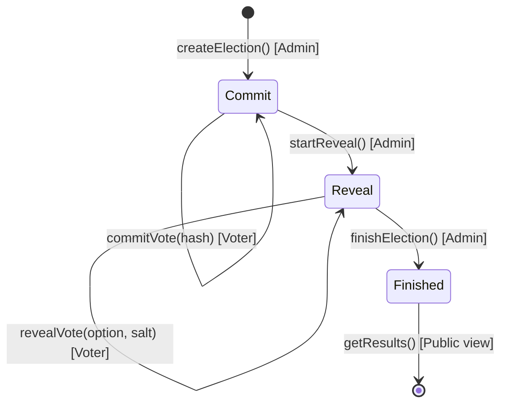
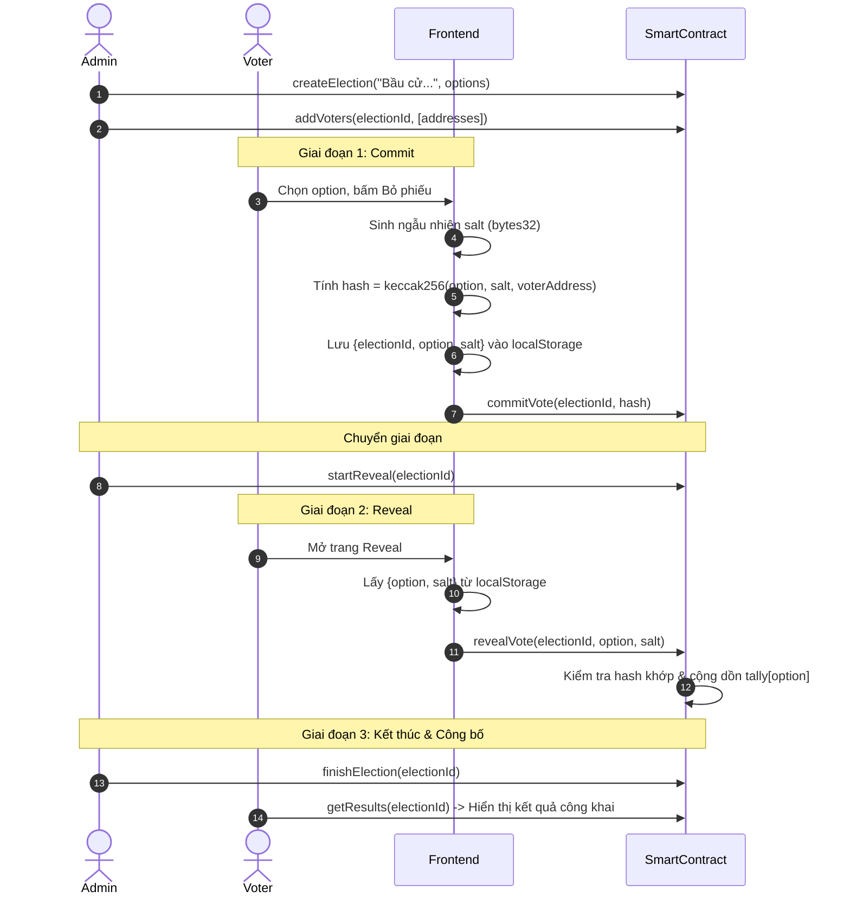
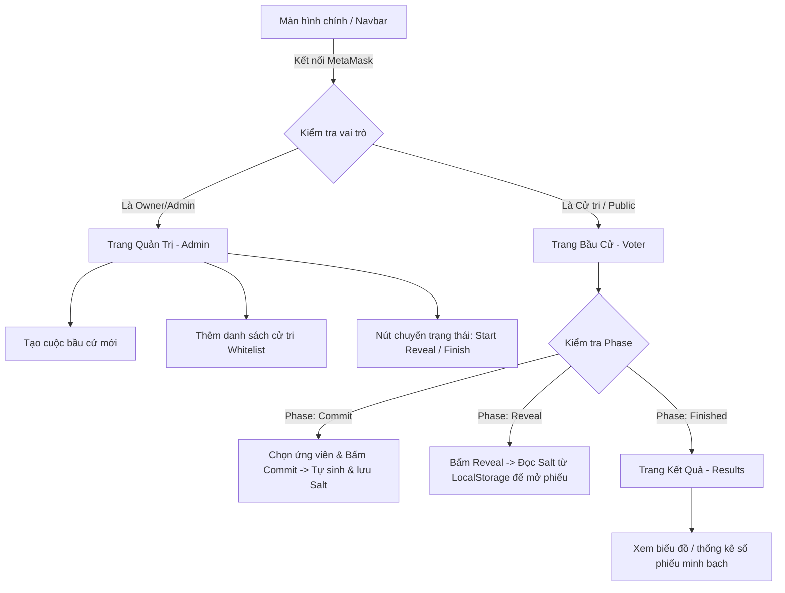

# Bản thiết kế Smart Contract Bỏ phiếu điện tử (EVoting)

Cập nhật: 2026-11-19

## 1. Mục tiêu và phạm vi
- Xây dựng smart contract quản lý bỏ phiếu an toàn, minh bạch trên mạng blockchain Ethereum (Sepolia testnet).
- Quản lý cử tri qua danh sách hợp lệ (whitelist bằng mapping).
- Áp dụng cơ chế commit-reveal để ẩn danh lựa chọn trong suốt giai đoạn bỏ phiếu.
- Cung cấp giao diện web cho phép cử tri và quản trị viên (admin) thao tác trực quan qua ví MetaMask.

---

## 2. Sơ đồ State Machine (Vòng đời cuộc bầu cử)

Mỗi cuộc bầu cử trải qua 3 giai đoạn tuần tự:



### Ràng buộc theo giai đoạn
- **Commit**: Admin có thể thêm cử tri; Cử tri hợp lệ gửi hash bí mật. Không được phép reveal hay xem kết quả.
- **Reveal**: Không nhận thêm cử tri và không nhận thêm phiếu commit; Cử tri gửi `option` và `salt` để mở phiếu.
- **Finished**: Đóng hoàn toàn việc bỏ phiếu và kiểm đếm; Cho phép công khai kết quả thống kê.

---

## 3. Bảng thành phần Smart Contract (Struct, Mapping, Event, Modifier)

### 3.1. Bảng Cấu trúc dữ liệu (Struct & Enum)

| Tên cấu trúc | Loại | Thành phần / Giá trị | Mô tả |
|---|---|---|---|
| `Phase` | `enum` | `Commit`, `Reveal`, `Finished` | 3 giai đoạn của một cuộc bầu cử |
| `Voter` | `struct` | `bool isWhitelisted`<br>`bool hasCommitted`<br>`bytes32 commitHash`<br>`bool hasRevealed` | Trạng thái quyền và tiến trình bầu của từng cử tri |
| `Election` | `struct` | `string name`<br>`string[] options`<br>`Phase phase`<br>`uint256 totalCommitted`<br>`uint256 totalRevealed` | Thông tin chi tiết và số liệu tổng hợp của cuộc bầu cử |

### 3.2. Bảng State Variables & Mappings

| Tên biến / Mapping | Kiểu dữ liệu | Phạm vi | Mô tả |
|---|---|---|---|
| `electionCount` | `uint256` | `public` | Tổng số lượng cuộc bầu cử đã khởi tạo |
| `elections` | `mapping(uint256 => Election)` | `public` | Lưu thông tin từng cuộc bầu cử theo `electionId` |
| `voters` | `mapping(uint256 => mapping(address => Voter))` | `public` | Lưu trạng thái của cử tri theo `(electionId, voterAddress)` |
| `tally` | `mapping(uint256 => mapping(uint256 => uint256))` | `public` | Kết quả đếm số phiếu theo `(electionId, optionIndex)` |

### 3.3. Bảng Events

| Tên Event | Tham số | Ý nghĩa |
|---|---|---|
| `ElectionCreated` | `uint256 indexed electionId, string name, string[] options` | Phát ra khi admin tạo cuộc bầu cử mới |
| `VotersAdded` | `uint256 indexed electionId, address[] voterAddresses` | Phát ra khi admin thêm cử tri vào whitelist |
| `PhaseChanged` | `uint256 indexed electionId, Phase newPhase` | Phát ra khi trạng thái giai đoạn bầu cử thay đổi |
| `VoteCommitted` | `uint256 indexed electionId, address indexed voter, bytes32 commitHash` | Phát ra khi cử tri gửi hash bỏ phiếu thành công |
| `VoteRevealed` | `uint256 indexed electionId, address indexed voter, uint256 option` | Phát ra khi cử tri mở phiếu hợp lệ và tally được cộng |

### 3.4. Bảng Modifiers & Ma trận phân quyền

| Modifier | Ràng buộc kiểm tra | Áp dụng cho hàm |
|---|---|---|
| `onlyOwner` | `msg.sender == owner()` | `createElection`, `addVoters`, `startReveal`, `finishElection` |
| `inPhase(electionId, expectedPhase)` | `elections[electionId].phase == expectedPhase` | `addVoters`, `commitVote`, `startReveal`, `revealVote`, `finishElection`, `getResults` |
| `onlyWhitelisted(electionId)` | `voters[electionId][msg.sender].isWhitelisted == true` | `commitVote`, `revealVote` |

---

## 4. Cơ chế Commit-Reveal chống gian lận

### 4.1. Quy tắc sinh Hash Commit
```solidity
commitHash = keccak256(abi.encodePacked(option, salt, msg.sender))
```
- **option**: Chỉ số lựa chọn (uint256).
- **salt**: Chuỗi ngẫu nhiên 32 bytes sinh tại client của cử tri.
- **msg.sender**: Địa chỉ ví cử tri.
- **Mục đích**: Gắn `msg.sender` vào hash để ngăn chặn kẻ tấn công copy hash của người khác trên Mempool và gửi lại (Front-running / Copy-commit attack).

### 4.2. Quy tắc Reveal
- Cử tri gửi `option` và `salt`.
- Contract tính toán lại hash và so sánh:
  `require(keccak256(abi.encodePacked(option, salt, msg.sender)) == voter.commitHash, "Invalid hash")`
- Nếu khớp: Đánh dấu `hasRevealed = true`, tăng `tally[electionId][option]++`, tăng `totalRevealed++`.

---

## 5. Sơ đồ tuần tự (Sequence Diagram)



---

## 6. Luồng màn hình Frontend (UI Flow)


